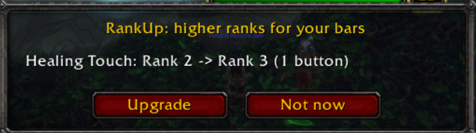

# Publishing on Wago Addons

Every addon is its own project on [Wago Addons](https://addons.wago.io), by
**Skyler**, under the repo's MIT [LICENSE](../LICENSE). Players install them
through WowUp (Wago edition), which knows WoW Forever as its own game.

What has gone up, and at which version, is in
[wago-uploads.json](../wago-uploads.json).

## Once per computer

Make an API key at <https://addons.wago.io/account/apikeys> and store it for
your Windows user, in your own PowerShell:

```powershell
[Environment]::SetEnvironmentVariable("WAGO_API_TOKEN", "<your key>", "User")
```

The key never goes in the repo or in a chat. `package.ps1` reads it from
there, even in a terminal opened before it was set.

## Once per addon

1. **Icon and thumbnail.** Every icon comes from
   [tools/draw-icons.mjs](../tools/draw-icons.mjs). A new addon gets a theme,
   a symbol and an `ICONS` entry there, then:

   ```powershell
   node tools/draw-icons.mjs . NewAddon                # its .tga files
   node tools/draw-icons.mjs . NewAddon --thumbnails   # docs/icons/NewAddon.png, 512px
   ```

   The thumbnail is drawn at full size from the same shapes, never scaled up
   from the 64px icon (that comes out blurry).

2. **Create the project** at addons.wago.io → Create Addon → **Custom Addon
   Creation**. Not "GitHub Addon Creation": that makes the whole repo one
   addon.

   | Field | What goes in it |
   |---|---|
   | Display Name | The addon's name, as in its `.toc` |
   | URL Slug | The name in lowercase, e.g. `rankup`; `<name>-skyler` if taken |
   | Summary | One sentence for players |
   | Description | Markdown, adapted from the addon's README for players: what it does, then its commands. Leave out install, test and code sections |
   | Addon License | `https://github.com/schele/WoWAddons/blob/main/LICENSE` (it wants a URL) |
   | Addon Source | `https://github.com/schele/WoWAddons` |
   | Support link | `https://github.com/schele/WoWAddons/issues` |
   | Website, Wiki, Discord | Empty |
   | Hide from 3rd party addon updaters | **Unticked**, or WowUp cannot see it |
   | Unlisted | Unticked |
   | Thumbnail | `docs/icons/<Addon>.png` |

3. **Put its project ID in the `.toc`.** The ID is on the project in Wago's
   developer dashboard, eight letters and digits:

   ```
   ## X-Wago-ID: E6gzYZN1
   ```

4. **Upload** with a release, below. The first one's changelog says "First
   release on Wago."

## Every release

Raise `## Version:` in the addon's `.toc`, then:

```powershell
.\package.ps1 RankUp -Install -WagoDryRun   # see what would be sent
.\package.ps1 RankUp -Install               # install, and upload to Wago
```

`-Install` uploads only a version that is not in `wago-uploads.json` yet, so
reinstalling while testing never reaches players. The upload ticks the game
versions from `## Interface:` (`11509` is Classic Era 1.15.9, `16001` is WoW
Forever 1.60.1) and builds the changelog from the commits that touched the
addon since its last upload. Commit `wago-uploads.json` afterwards.

`-NoWago` installs without uploading; `-Stability beta` or `alpha` marks a
pre-release.

An upload publishes to players, so it is never part of a "commit and push":
it happens when asked for by name.

## Checking it is public

Open `https://addons.wago.io/addons/<slug>` in a private window. In WowUp,
pick World of Warcraft: Forever → Get Addons and search for it; a newly
created project can take a while to appear there.

## Screenshots in a description

Images live in `docs/screenshots/<Addon>/` and are linked by their raw
GitHub URL once pushed:

```markdown

```

Crop to the part that matters; a full screenshot shrinks to the page width.
Check for player names you would rather not publish.
